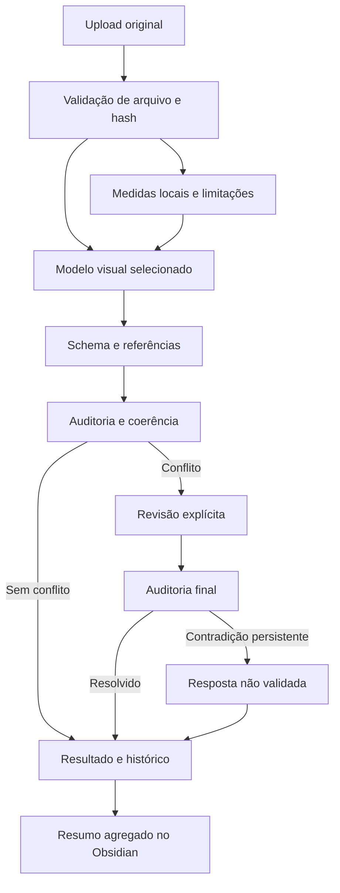

# Arquitetura

[[Inicio]] · [[Qualidade e contradicoes]] · [[Rede neural]] · [[Validacao]]

React apresenta a análise; Python executa medições, chama Gemini ou LM Studio e persiste os resultados. O caminho de inferência local exige modo de desenvolvimento. A rede CNN é experimental e possui treino e predição próprios, descritos em [[Rede neural]].

Nenhuma escolha de provedor deve ocorrer silenciosamente. Listar um modelo não demonstra que ele compreenda imagens ou acerte a tarefa.
